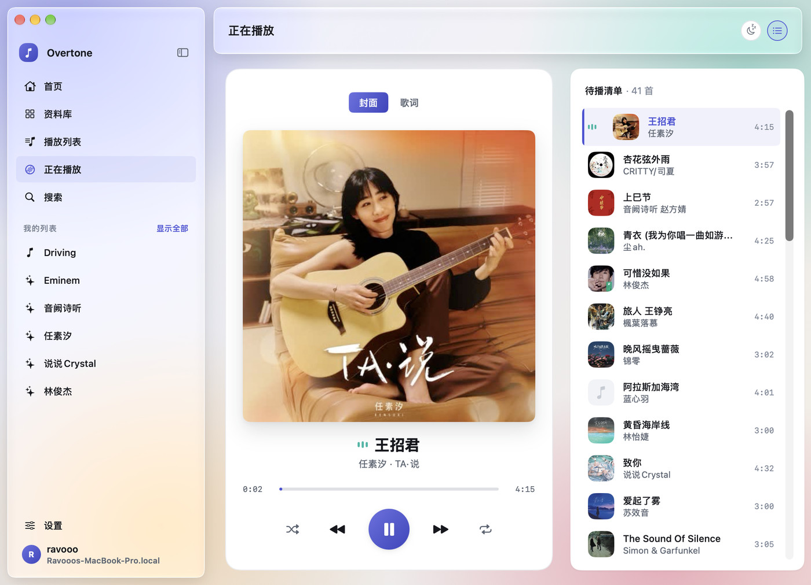
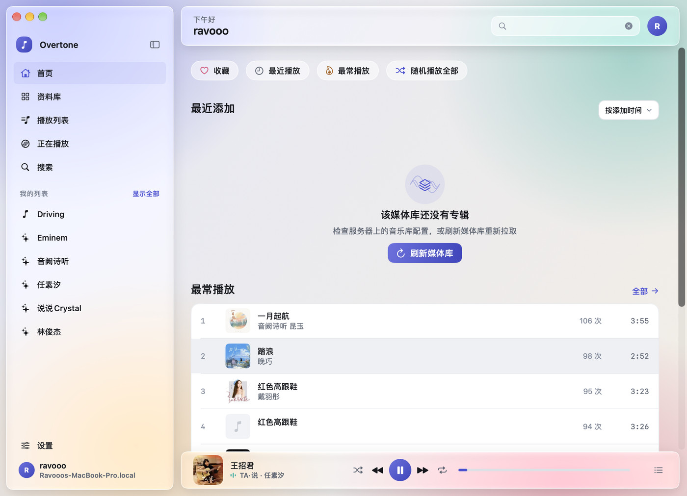
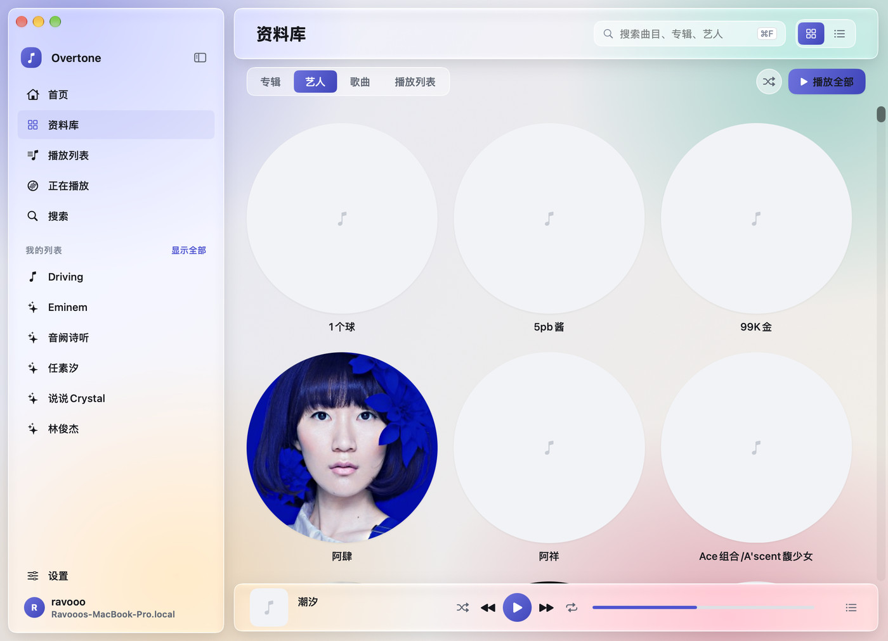
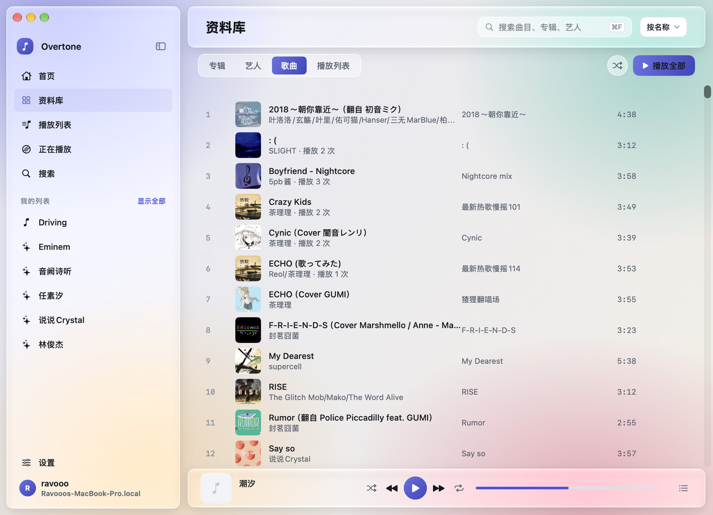
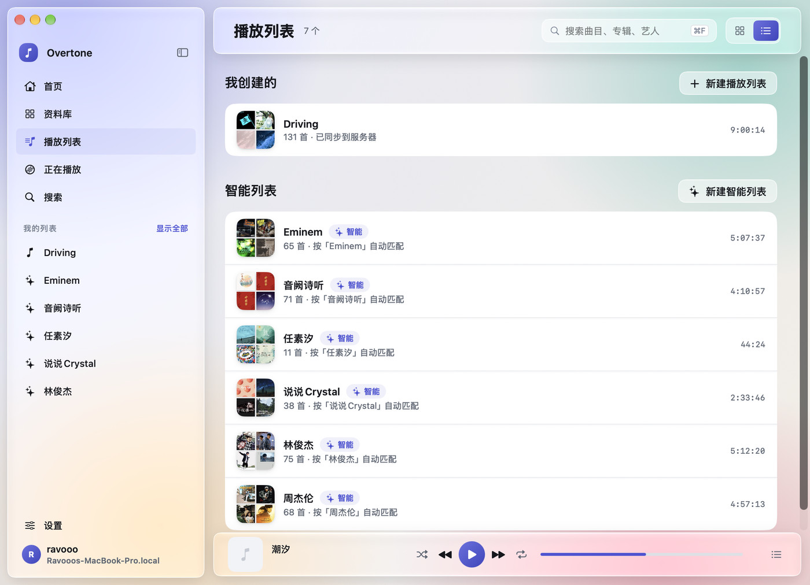
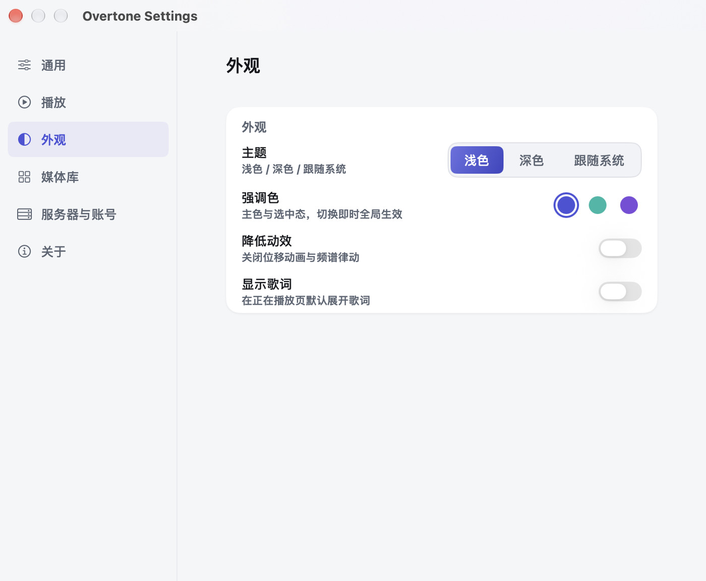
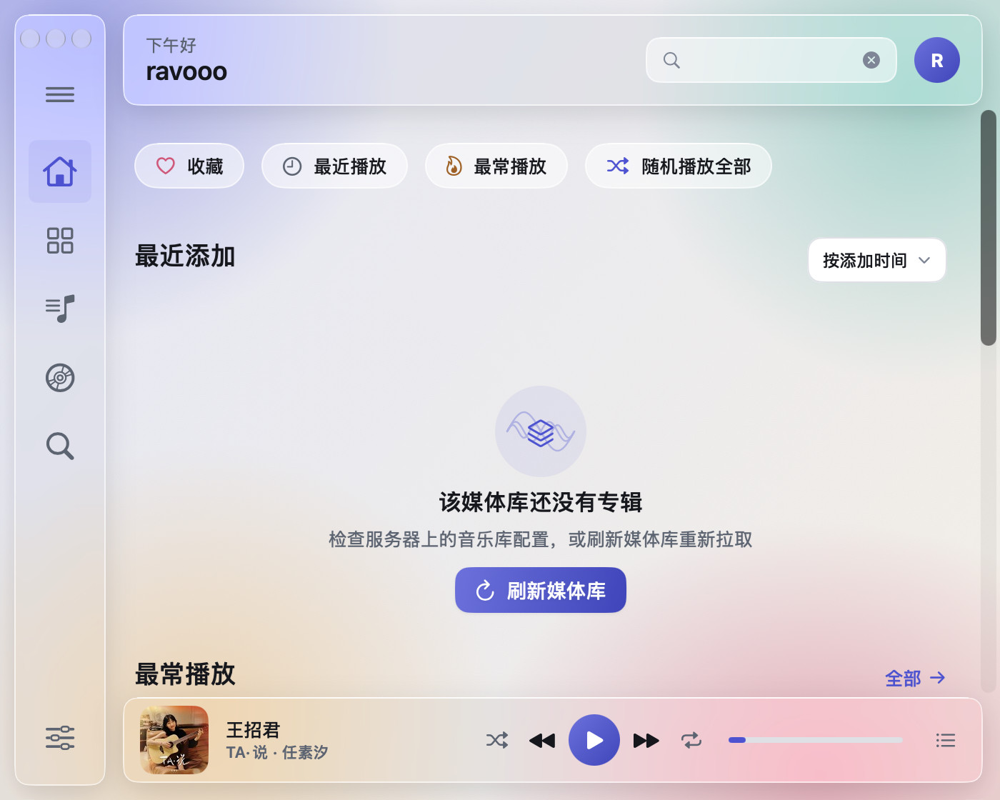

# Overtone（泛音）

原生 macOS 音乐客户端 · **支持 Jellyfin 与飞牛音乐（fnOS）双后端** · SwiftUI 编写 · Liquid Glass 玻璃材质 · 靛蓝主音 / 泛音青双色体系

> **关于名字**：Overtone 是「泛音」——基音之上叠加的谐波，中文名本身就是现成的音乐术语。本项目是**非官方**客户端，与 Jellyfin 项目无隶属关系。



| 首页 | 资料库 · 艺人 |
|---|---|
|  |  |

| 资料库 · 歌曲 | 播放列表 |
|---|---|
|  |  |

| 设置 · 外观 | 窄窗口图标栏 |
|---|---|
|  |  |

## 功能

- **双后端**：登录页选「Jellyfin」或「飞牛音乐」；两套后端共用同一套界面与播放链路，设置页可切换；凭据按后端分别保存，同名账号互不覆盖
- **登录**：左右分栏（品牌区 + 表单卡），高级选项可配协议 / 端口 / 客户端名；记住会话，重启免登录；飞牛侧支持可选安全码
- **首页**：继续播放 · 快速入口（收藏 / 最近播放 / 最常播放 / 听歌统计 / 随机播放全部）· 最近添加 · 最常播放 Top 10
- **听歌统计**：本地记录每次播放的时间、时长与曲目，提供近 7 天 / 30 天 / 一年 / 全部四档、播放热力图、时段分布与 Top 歌曲 / 艺人 / 专辑；年度报告支持分享长图（数据只存本机，不上传）
- **听歌记录**：可选把播放记录同步到 Last.fm / ListenBrainz（≥50% 或 ≥4 分钟才计入，含 Now Playing、失败补报队列；凭据存钥匙串，可随时关闭）
- **资料库**：专辑 / 艺人 / 歌曲 / 播放列表四分段，网格与列表双视图，排序菜单，骨架屏加载
- **播放列表**：本地列表 + 按艺术家关键字自动收集的智能列表，可与服务器双向同步；曲目可上移 / 下移
- **详情页**：专辑 / 艺人 / 播放列表统一骨架 —— 面包屑返回栏 + 大封面头部 + 曲目表
- **搜索**：搜索框常驻内容区顶栏（⌘F 聚焦），结果按歌曲 / 专辑 / 艺人 / 播放列表分组
- **设置页**：通用 / 播放 / 外观 / 媒体库 / 听歌记录 / 服务器与账号 / 关于 七个分组（⌘, 打开）
- **视觉风格双轨**：外观里可切「玻璃 Liquid Glass」（v3，默认）/「纸墨 Tape & Signal」（v4）——即时生效、重启保持；两套风格共用同一份信息架构与五档断点，切风格不丢导航与搜索词
- **播放器**：原生 AVPlayer，全局迷你播放条（三区布局，窄窗降级两区），正在播放页（大封面 + 5 键控制 + 待播清单 + 歌词 + 睡眠定时）
- **播放衔接**：下一首预取；双播放器真交叉淡化（可设 0–12s，手动切歌约 1s 过渡；转码 / HLS / 未预取时降级为淡出→直切）；队列播完后自动用 Jellyfin InstantMix 续播相似歌曲；队列可跨重启恢复（同后端、7 天内、默认不自动播放）
- **歌词**：同步歌词滚动；歌词偏移 ±2s（补偿蓝牙延迟）；沉浸式全屏歌词（点行跳转、Esc 退出）
- **播放容错**：监听 `AVPlayerItem.status` / `FailedToPlayToEndTime` / 缓冲状态；直连失败时自动回退到服务器转码源一次，再失败才报错停播
- **进度同步 / 直连优先**：播放进度按设置的间隔上报服务器；默认直接播放原始文件，关闭直连或选非原始音质时自动走服务器转码
- **本地兜底**：服务器没有的能力自动落到本机 —— 飞牛音乐没有播放进度 / 播放次数 / 专辑艺人收藏，这三项由本地记录（继续播放、最常播放、专辑收藏照常可用，换设备不同步）
- **同一首歌只存一份**：Jellyfin 与飞牛音乐都有的曲目按「标题 + 艺人 + 时长」识别为同一首，播放进度 / 播放次数 / 收藏跨后端共享，封面（以及图片缓存）也只存一份，不再两边各记一遍
- **能力门控**：不支持的能力置灰并给说明（如飞牛没有进度上报时「进度上报间隔」不可调），不是静默失败
- **窄窗口五档**：侧栏在窄窗口降级为 64pt 图标栏（W1 可展开 240pt 抽屉），不丢导航；完整侧栏也可用 logo 行的按钮手动收成图标栏

## 快速开始

需要 macOS 13+（推荐 14）与 Xcode 15+ 工具链；只装 Command Line Tools 也能构建，原因见[构建笔记](docs/build-notes.md)。

```bash
./scripts/generate-icon.sh   # 生成图标（首次或换图标时）
./scripts/build-app.sh       # 打包成 build/Overtone.app
open build/Overtone.app
```

开发调试可直接 `swift run`；跑纯逻辑自检（不需要服务器与 Xcode）：

```bash
./scripts/dev-test.sh        # 321 项断言：后端协议 / 地址规范化 / 时长 / 歌词 / 本地合并 / 统计聚合 / Scrobble 规则 / 播放衔接
./scripts/dev-typecheck.sh   # 只是编译（多人并行改代码时用：内部有目录锁）
```

`swift run JellyfinMac --selftest` 也能直接跑同一组断言（失败返回非 0）。

飞牛音乐侧还可以从命令行验证 FN Connect 解析（不需要界面、不需要账号）：

```bash
swift run JellyfinMac --fn-resolve ravooo   # 打印定位到的候选地址 + 逐个探测结果 + 最终基址
```

首次使用：选服务器类型 → 填地址（Jellyfin 如 `http://192.168.1.10:8096`，可省略 `http://`；飞牛填 NAS 地址，如 `192.168.1.10:5666`，后端会自动补 `/music`）、用户名与密码，点「连接服务器」；
首页会自动加载继续播放、最近添加与最常播放，侧栏可切换资料库 / 播放列表 / 正在播放 / 搜索。

## 快捷键

| 快捷键 | 行为 |
|---|---|
| `⌘F` | 聚焦搜索框（任何场景） |
| `空格` | 播放 / 暂停（输入框聚焦时放行给输入框） |
| `⌘→ / ⌘←` | 下一曲 / 上一曲 |
| `⌘[` | 返回上一级 |
| `⌘1 … ⌘5` | 切换一级页（首页 / 资料库 / 播放列表 / 正在播放 / 搜索） |
| `⌘,` | 打开设置 |
| `Esc` | 收起图标栏展开的抽屉 |

## 项目结构

```
[侧栏 240 / 图标栏 64] | [内容区顶栏 64] [滚动区] [迷你播放条 68]

Sources/JellyfinMac/
├── JellyfinApp.swift        # 入口、AppDelegate、RootView、设置窗口
├── Theme.swift              # 设计令牌（颜色/字体/间距/圆角/阴影/动效）+ 五档断点
├── Models/Domain/           # 领域模型（MediaItem / ArtworkRef / MediaUserData / Paged）
├── Backend/                 # MusicBackend 协议 + 后端注册表与会话
│   ├── Jellyfin/            # Jellyfin 适配器（wire DTO + 10 类端点）
│   └── Feiniu/              # 飞牛音乐适配器（authx 签名 / 地址规范化 / LRC / 转码）
├── Networking/              # HTTPClient（逐请求凭据 / 独立 Cookie）+ ArtworkResolver
├── State/                   # 会话、设置、曲库、播放列表；Local/ = 本地兜底存储
├── Components/              # 按钮、分段、封面卡片、曲目表、迷你播放条……
├── ViewModels/              # 搜索
├── Views/                   # 登录、主框架、首页、设置、Music（资料库 / 详情 / 正在播放 / 队列）
├── Player/                  # 播放器模型 + 资源加载器（逐请求签名代理）
└── Diagnostics/             # 内置自检（pure-function 断言）
```

分层与「加第三个后端要动哪些文件」见 [多后端架构](docs/architecture-multibackend.md)。

设计令牌全部收敛在 `Sources/JellyfinMac/Theme.swift`，页面里不出现硬编码色值与圆角；字号统一走
`.textStyle(_:)`，随系统文本大小缩放。令牌分两套「视觉风格」同时构造、切换只换引用
（`VisualStyle.glass` / `.paper`，页面侧一律写 `Theme.isPaper ? 纸墨 : 原玻璃代码`），
所以两套皮肤共享同一份视图与断点，玻璃模式的取值与 v3 逐字节一致。可访问性：图标按钮均有
`accessibilityLabel`，hover 控件在键盘聚焦时同样出现，进度条可键盘 ±5s 微调，尊重系统「减少动态效果」。

## 已知限制

- 播放器暂不支持字幕 / 音轨切换（跟随服务器默认轨道）
- 同时只能登录一个后端：设置页切换后端会重新加载曲库（已保存的凭据分别保留，切回去免登录）
- 飞牛音乐侧：支持 **FN Connect**（登录页直接填 FN ID，自动定位/选路/中继；本机实测内网、公网 IPv6、relay 均可通）；CUE 整轨偏移与 `accessStatus != 0` 曲目未特殊处理
- 飞牛音乐没有播放进度 / 播放次数 / 专辑艺人收藏：这三项只记在本机（继续播放、最常播放、专辑收藏可用但不跨设备）
- 交叉淡化已改为双播放器真交叉，但**未做真机听感验证**（本机无服务器 / 音频设备）：双流重叠、备用流起播延迟与极端时序可能仍需调参；转码 / HLS / 未预取时降级为淡出→直切
- 听歌统计只保存在本机、不跨设备；统计以「开始播放」为一次播放，收听时长按进度上报采样（默认 10s）估算
- 听歌记录（Last.fm / ListenBrainz）需要自备 API Key / 令牌，默认关闭；网络失败静默重试，不阻塞播放
- 队列恢复限定同一后端且 7 天内；恢复后不自动播放，按播放键从上次位置继续
- 曲库首屏最多加载 5,000 首（之后提示截断），尚无真分页懒加载
- 飞牛侧的协议兼容性未在真机验证：`authx` 是否强制、转码 HLS 能否被 AVPlayer 播放、Range 支持，见架构文档 §5
- 纸墨风格的侧栏是「悬浮纸面板」（四边细线），不是 v4 预览里的贴边 + 1px 右细线 —— 改贴边要同时动断点宽度计算与红黄绿三键定位
- 切换视觉风格会重建窗口呈现层：滚动位置等瞬态状态复位，导航栈 / 搜索词 / 侧栏宽度保留
- 播放列表曲目排序提供「上移 / 下移」（拖拽排序的键盘等价物），暂无拖拽把手

## 更多文档

- [多后端架构](docs/architecture-multibackend.md)：领域模型 / `MusicBackend` 协议 / 双适配器 / 播放链路（逐请求签名）/ 本地兜底 / 能力门控，以及「加第三个后端」的步骤
- [接入飞牛云 NAS 工作量评估](docs/fnos-integration-assessment.md)：三条路径（NAS 装 Jellyfin 零改动 / 自研飞牛音乐私有协议 / 通用 Subsonic 后端）的人日估算、功能落差与 P0 spike 清单；支撑调研见 [`docs/research/`](docs/research/)
- [界面设计规范 v5「暖阳胶片」](docs/ui-design/UI-Redesign-v5.md) · [高保真预览](docs/ui-design/UI-Redesign-v5-preview.html)（Magazine 摄影风 · 日光 / 暗房双主题 + 强调色 / 宽窄窗切换；**规范与预览已出，尚未落地**，落地路径见规范 §9）
- [界面设计规范 v4「纸带与信号」](docs/ui-design/UI-Redesign-v4.md) · [高保真预览](docs/ui-design/UI-Redesign-v4-preview.html)（Editorial 印刷风 · 双主题 + 强调色/宽窄窗切换）；[界面设计规范 v3](docs/ui-design/UI-Redesign-v3.md) · [高保真预览](docs/ui-design/UI-Redesign-v3-preview.html)（双主题 + 材质开关）；早期 [v2 规范](docs/ui-design/UI-Design-Spec.md) · [v2 预览](docs/ui-design/preview.html)
- [构建笔记](docs/build-notes.md)：外观为什么取决于 SDK 版本、没有 Xcode 时的宏插件兜底、自动打包
- [应用图标](docs/app-icon.md)：主图规范与换图标流程
- [命名与内部标识](docs/naming.md)：产品名与 target / Bundle ID / 数据目录的解耦

## 许可

仅用于个人学习使用。Jellyfin 是 Jellyfin 团队的商标，本项目是**非官方**客户端，与其无隶属关系。
